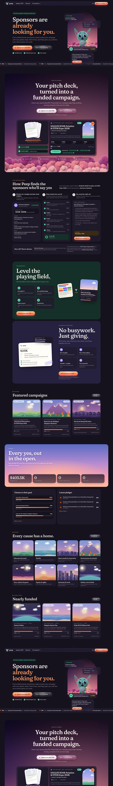
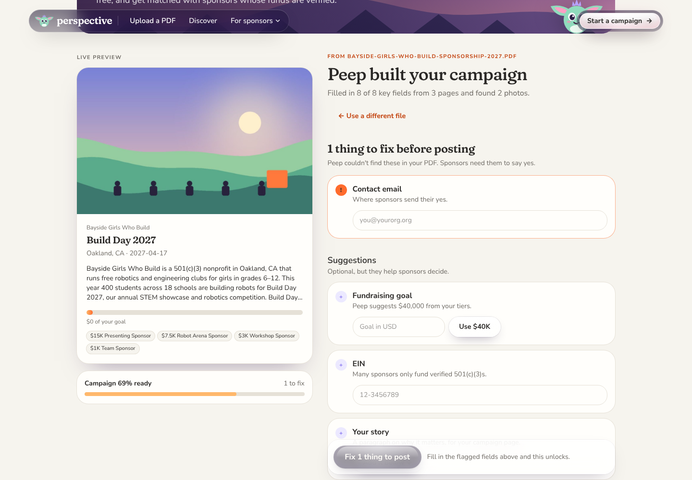
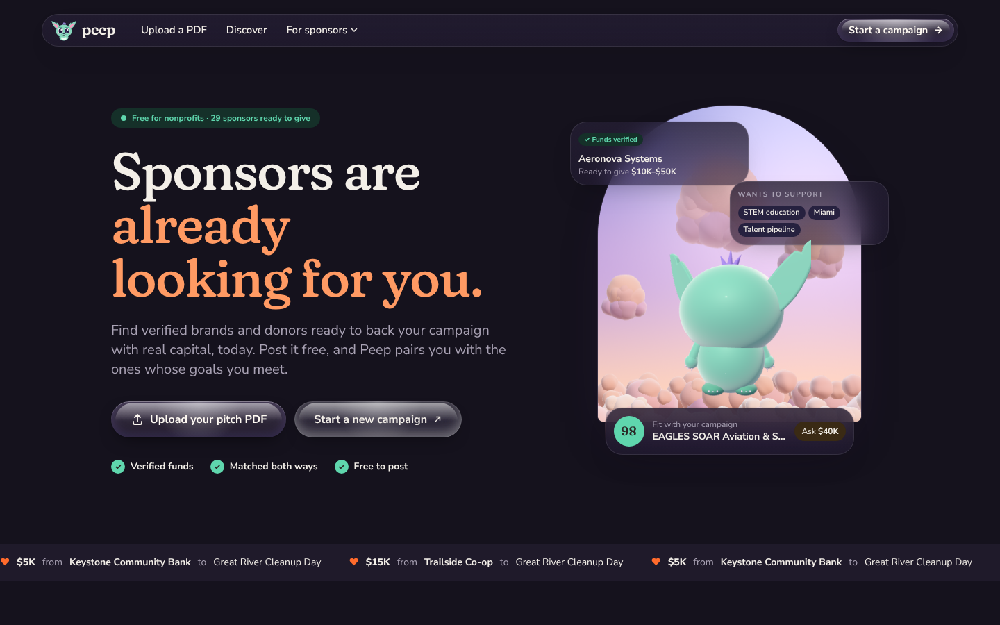

# Peep

**Turn a nonprofit's pitch deck into a funded campaign.** Drop in a sponsorship PDF; Peep builds the campaign, flags anything missing, then pairs it with brands and donors whose funds are verified and whose giving goals it meets.

**Why it exists, for each side:**
- **Nonprofits get a level playing field.** Most pitch decks can't compete on design with the brands they're sent to. Peep turns any deck, PDF or written pitch into the same polished campaign format, so every cause starts out looking its best. Organizations can add their own story, photos and copy on top.
- **Brands get giving without the busywork.** A brand sets its giving budget, picks the causes and places it cares about, and Peep matches it with campaigns that fit. Peep moves the funds, confirms they reached the nonprofit, and hands over the tax receipt once the transfer clears. Brands can say thanks, set up calls, or keep contact to the essentials.

> In this prototype, funds transfer, verification and tax receipts are described in the product copy but not built. Pledges are recorded commitments; no money moves.

Think grant finder, but for sponsorships and corporate giving, across every cause and every kind of sponsor. It's two-sided, every match comes with its reasons, and every match ends in a drafted pitch or a double opt-in introduction.



## What's in the prototype

Peep borrows the crowdfunding model from Kickstarter and GoFundMe:
- **Campaigns** have a goal, a progress bar and reward-style tiers.
- **Sponsors** pledge to a tier.
- **Discovery** works by category, with sorts like "Nearly funded".

The difference is that every campaign also shows which sponsors fit it and why.

The site speaks to nonprofits first, and everything for sponsors sits in one "For sponsors" menu. The home page tells the story in order:
1. **Hero:** the promise. Sponsors with verified funds, matched to your cause, with a live example (a sponsor's budget, what it wants to fund, and its fit score) floating around Peep.
2. **Start in a minute:** the PDF upload, with a demo of a pitch deck building itself into a finished campaign one-pager (cause art, title, date and place, tiers, funding) and posting.
3. **How matching works:** one real match walked through in three steps (what the sponsor funds, the six checks with their notes and points, the drafted ask), plus how misfits are filtered out both ways.
4. Featured campaigns, pledges, causes, nearly funded, FAQ.

### PDF → campaign

1. **Read** (`lib/pdf-read.ts`): pdf.js runs in the browser and pulls out the text layer, the embedded photos (as JPEGs, largest first) and page previews. It loads on demand, and the same code runs in the single-file build.
2. **Fill**: the text goes to `/api/extract`. With `ANTHROPIC_API_KEY` set, Claude reads the PDF itself, which also handles scans and complex layouts. Without a key, the rule-based parser reads the text, including deck layouts: letter-spaced headings, "X is a 501(c)(3)" intros, and tier benefits listed under each tier.
3. **Check** (`lib/campaign-check.ts`): required gaps (organization, campaign name, pitch, cause, location, tiers, contact email, a future date for events) must be fixed before posting. Recommended ones (goal, with a suggestion from the tiers; EIN; cover photo; audience; story) are flagged but optional.
4. **Post**: the campaign saves with its cover and gallery photos, and opens with its best-fit sponsors.



| Flow | Route | What it does |
|---|---|---|
| Discover | `/opportunities` | Browse live campaigns by cause group, with filters and sorts: happening soon, nearly funded, just launched, most sponsors, biggest goals. |
| Campaign | `/opportunities/[id]` | A Peep one-pager: a poster with the title, organizer, date, place and funding, beside an arch window with an animated illustration for the cause. Then numbered chapters: the story (with a pull quote and polaroid photos), at a glance, best-fit sponsors with drafted outreach, and who's backed it. Funding stats and the tiers ("X of Y left", pledge) sit in a sticky column. |
| Start a campaign | `/find` | GoFundMe-style five-step flow (basics, causes, place and time, goal and tiers, asks), then a review with a card preview, matching sponsors, and launch. |
| Upload a pitch PDF | `/import` | Drop a sponsorship deck or one-pager. Peep reads the text and photos, fills in the campaign, flags what's missing (required gaps block posting), and posts it free. A sample deck is built in; pasting a pitch email still works. |
| For sponsors | `/give` | The 1% floor calculator with a bunching planner, the standing disaster pool, and the matcher: a brand or donor sets its goals and gets ranked campaigns (a small organization always gets a top-five spot). |
| Brand profile | `/sponsors/[id]` | A brand's public page: brand kit preview (the rest locked until a gift clears), Peep Pledge badge, budget year and best time to ask, and a "Pitch this brand" panel that enforces fit, lead time and one pitch per organization per quarter. |
| Brand dashboard | `/brand/[id]` | Pitch inbox (interested, or decline with a reason), gifts and receipts with kit access and renewals, placement photos to approve, the brand kit editor with a tagline guard, the request link, a team vote, settings (budget year, giving budget, disaster pool, Peep Pledge), an impact digest and the year-end finance CSV. |
| Request link | `/request/[id]` | What a brand puts on its site instead of a donations inbox: its criteria, then "upload your pitch PDF" (posted campaigns go straight to its inbox) or pick an existing campaign. |
| Receipt | `/receipts/[id]` | Where the money is: a timeline (pledged, cleared, confirmed, receipt issued), the checks run at payout, and the right document, a charitable acknowledgment or a sponsorship invoice, ready to print. |
| Intros | `/intros` | Double opt-in intro pipeline: requested → opted in → introduced → won/passed. |

**Pledges are commitments, not payments.** No money moves in the prototype; the receipt page has "play the nonprofit" buttons that stand in for the transfer landing. Each pledge records:
- **Gift or sponsorship.** A gift gets a charitable acknowledgment with the right quid pro quo statement; a sponsorship gets an invoice for the brand's books as a business expense (no 1% floor). Tier cards are labeled "Gift-ready", "Gift with perks" or "Sponsorship (has advertising)" by `lib/compliance.ts`, which reads each benefit in IRC 513(i) terms.
- **Recognition:** public, private (only the nonprofit knows) or anonymous. Anything but public keeps the brand kit locked.
- **Contact:** keep in touch, or just the essentials.
- **Renewal**, **circle shares** (tiers of $4K+ can be split four ways by local businesses) and **Peep's 3% fee**, paid by the sponsor on top so the nonprofit receives the full amount.

**Every campaign takes unrestricted gifts.** "General operating support" sits under the tiers, any amount, always a clean gift.

**The asset vault.** Each brand has a kit (logos as SVG, colors, approved tagline and boilerplate, usage rules). It's drafted from public info until the brand uploads its own (`lib/brand-kit.ts`). A nonprofit sees a backer's full kit on its campaign page once that gift clears, for a year, unless the brand closes it. The nonprofit uploads placement photos; the brand approves them from its dashboard. Going the other way, each campaign has a **story kit** (numbers, a quote, photos) that backers can reuse.

**Consent first.** A campaign only goes live when someone from the organization approves it; the page records who and when. Campaigns with a valid EIN, a 501(c)(3) org type and consent show **Peep Verified** (the IRS and sanctions checks are simulated in the prototype).

**Pledges follow the matching rules.** A sponsor in the network can't pledge to a campaign it's blocked from (a cause it excludes, or an industry the organization declines). Tiers also stop accepting pledges once their slots fill.

The featured campaign **EAGLES SOAR Aviation & STEM Expo 2026** is real. It's built from the Richard P. Hall Eagles Foundation's outreach email and sponsorship package, with no pledges recorded yet.

Everything else in the demo network is fictional and labeled "Sample" in the UI: 19 organizations and 29 sponsors.
- **Organizations:** food banks, animal rescues, youth sports, arts festivals, rural health, refugee services, recovery, disaster preparedness, adaptive sports and more, across 17 states plus one national virtual campaign.
- **Sponsors:** national brands, local businesses, foundations, individual donors and a public agency, across 20+ industries.

**Coverage**
- **Causes:** 36 cause areas in 8 groups, each mapped to an NTEE major group (the IRS nonprofit classification), so listings can later be checked against IRS records.
- **Sponsor industries:** 30, from pet products to professional services.

See [`docs/PRODUCT.md`](docs/PRODUCT.md) for the product brief: problem, matching model, data strategy, business model and roadmap.

## Run it

```bash
npm install
npm run dev        # http://localhost:3000
```

Optional: copy `.env.example` to `.env.local` and set `ANTHROPIC_API_KEY`. This turns on Claude for PDF import, which reads scanned pages and benefit grids much better. Without a key, PDFs are read in the browser and the rule-based parser fills in the campaign.

```bash
npm test           # matching, extraction and outreach unit tests (node:test)
npm run typecheck
npm run build
```

## Standalone HTML build

```bash
npm run build:static   # → out-static/peep.html (one file)
```

This produces the whole site as a single self-contained HTML file you can open by double-clicking. No server or install needed.

**What runs in the browser:**
- The same pages and components as the Next app.
- The same API route handlers, answered locally by a small fetch layer instead of a server.

**How it works:**
- Pages render through an in-memory router.
- Next-only modules are swapped for small browser stand-ins in `static/`.
- Anything a visitor creates (campaigns, pledges, intros) is saved in their browser's localStorage.

**Limitation:** PDF import reads in the browser and uses the rule-based parser here, because there's no server to hold an API key. Scanned PDFs (no text layer) still give you their photos, but the fields need filling in by hand.

The build also writes `out-static/artifact.html`, the same page without the `<html>`/`<head>`/`<body>` wrapper, for hosts that add their own.

## Design

The visual language is a storybook at dusk, inspired by [Passionfroot](https://www.passionfroot.me):
- **Pages and type:** cream paper pages, Fraunces with its soft-corner axis for headlines and Nunito Sans for UI, self-hosted through `@fontsource`.
- **Environments:** windows onto live 3D scenes built with three.js (`components/scene/`), in different shapes: an arch in the hero, a wide panel for the PDF demo, and a band behind the pledge stats.
  - The hero is an arched window onto a daytime cloudscape.
  - The PDF section is a starry night over drifting sunset clouds; the pledges band is a mountain forest at dusk.
  - Scenes load three.js on demand, pause off screen, render a single still frame under `prefers-reduced-motion`, and fall back to a painted CSS sky without WebGL.
- **Peep, your campaign manager:** a sassy, evil-cute gremlin built from primitives (`components/scene/gremlin.ts`). She lives on her own transparent stage (`components/scene/stage.ts`, `components/PeepCompanion.tsx`) that floats over every page. She stands in the hero's arch and rides along with the page as you scroll, then hops along an arc into the corner and follows you around the site.
  - **Voice:** warm, dramatic, a little extra, with Miami flair, all in English (`lib/peep-lines.ts`). She says "literally" and "mmmwhat?", and pluralizes things to be cute: "good mornings", "thank yous", "I goes to sleeps".
  - **Moods:** idle, happy, love, mischief, sass (one brow up, a smirk), angry, attention, surprised and sleepy. She blends between them, blinks, flicks her ears, follows the pointer with eased-in eyes, and fidgets.
  - **Touch:** hover to tickle her (she purrs, giggles, squirms, and hearts float up out of her and drift away over the page). Click for a giggle, spin, sass or ear-pop; poke too much and she gets cross. Grab her and she dangles and flails; let go gently and she hops home; fling her and she tumbles off the page.
  - **After a throw:** she sulks off screen, then pops up her ears and eyes from the bottom edge to peek at you ("Ok, well... I'll just be here..."). Click her while she peeks to bring her back, or she sneaks back on her own after a few peeks. Now and then she plays peekaboo from the corner too.
  - **Her lantern:** she carries a little oil lantern. Stop scrolling and she sets it down beside her; scroll and she grabs it again. In dark mode it glows and lights her up.
  - **Guide:** she greets you on each page and, if you go idle, knocks on the glass and points to the next step. Then she gets impatient (arms folded, right claw on her left elbow, foot tapping), then she naps. Head for the browser's close button and she gets angry. She narrates the PDF import and cheers when you post a campaign or pledge.
  - **Sounds:** grunts, giggles, purrs, a "mmm-what?", a "wheee" and a lantern clink, synthesized with Web Audio (`lib/peep-sound.ts`). They start after your first click or key press and can be muted from the corner.
  - Any page can talk to her through window events (`lib/peep-events.ts`).
  - A 2D version is the logo mark and favicon.
- **Glass bubble buttons:** the main call to action is a warm orange candy-glass pill that glows, catches a sweeping glint every few seconds and nudges its arrow on hover; every other button is a frosted glass pill with a curved specular shine, a glint that follows the pointer, a soap-film rim that swirls on hover, a jelly squish on press and a pop ring on click (`app/globals.css`, `components/ButtonFX.tsx`).
- **Less to read at once:** long lists and secondary detail (the rest of a story, extra facts, more matches, a sponsor's reasons, extra tier benefits, older pledges) sit behind small "show more" toggles (`components/More.tsx`).
- **Demos that fit:** the PDF demo and the matching walkthrough scale to fit one window (`components/home/WatchFrame.tsx`), and grow slightly with a soft glow as they scroll into view, a nudge to watch.
- **Real data everywhere:** the hero card, the PDF demo and the matching walkthrough all use the EAGLES SOAR campaign and its actual top match.
- **Campaign covers:** painted landscapes generated per cause group (sunrise hills, a calm sea, a village, a mountain forest, a night sky, dunes, a city, a planet), varied per campaign.
- **Cause illustrations:** each campaign page gets an animated scene picked from its title, then its causes (`components/CauseArt.tsx`): paper planes and a rocket for aviation, an atom and gears for STEM, a book turning its pages, paw prints and a bouncing ball, produce dropping into a basket, a beating heart and ECG line, falling leaves and a sprout, curtains and floating notes, a bouncing ball and trophy, a street whose windows light up, an umbrella in the rain with a rainbow after, and a cheering crowd.
- **Why Peep:** two panels, one per side. "Level the playing field." shows a homemade deck turning into a polished Peep one-pager; "No busywork. Just giving." shows a giving budget and a verified donation receipt. Each has four short points in icon cards, and key words get a hand-drawn scribble that draws itself (`components/home/WhyPeep.tsx`).
- **Themes and motion:** tokens live in `app/globals.css`, with light and dark themes. The site opens in dark mode; the sun/moon toggle in the header switches to light (saved per browser, `lib/theme.ts`). In dark mode the hero's arch is a starry night. All motion respects `prefers-reduced-motion`.



## How matching works

Scores (0–100) are the sum of six factors, each shown in the UI's "Score breakdown":

| Factor | Pts | Notes |
|---|---|---|
| Cause fit | 30 | Both sides' causes are priority-weighted; adjacent causes and the brand's industry (pet brand ↔ animal welfare) earn partial credit |
| Geography | 20 | Home metro > giving area > national |
| Budget | 15 | Picks the largest tier inside the sponsor's typical gift range |
| Audience | 15 | Who the event reaches vs. who the sponsor targets |
| Objectives | 15 | Infers what the package offers (talent pipeline, visibility, access…) from tier benefits |
| Timing | 5 | Event date vs. the sponsor's decision lead time |

The score then passes through these rules:
- **Blockers:** 501(c)(3)-only sponsors, causes a sponsor won't fund, sponsor industries an organization won't accept (e.g. a youth league declining alcohol or betting), past events → "Not eligible"
- **Out-of-area cap:** local and regional givers top out at 45 outside their giving area
- **Relevance gate:** off-mission logistics are discounted
- **Core-cause cap:** "Excellent" requires hitting a core cause
- **Support mismatch:** −10

Code: [`lib/match.ts`](lib/match.ts).

## Layout

```
app/                 Next.js App Router pages and API routes
  api/extract        pitch → listing (Claude or rules)
  api/match          score a draft listing/profile without saving
  api/opportunities  save a listing
  api/sponsors       save a sponsor profile
  api/intros         create / update intro requests
  api/pledges        pledge to a tier (slots, circles, blockers enforced); [id] clears, confirms, proofs, kit access, renewals
  api/sponsors/[id]  update a brand's kit (tagline guard), budget year, budget, disaster pool, Peep Pledge
  api/pitches        pitch a brand (fit, lead time and quarterly quota enforced); [id] replies
  api/votes          team votes on where a pool goes
components/          UI (forms, match cards, outreach drafts)
lib/
  taxonomy.ts        causes (NTEE-mapped), audiences, objectives, industries, regions
  match.ts           scoring engine
  funding.ts         goals, pledges, tier slots, days to go
  extract.ts         rule-based pitch parser
  pdf-read.ts        in-browser PDF reading: text, photos, page previews
  campaign-check.ts  what a campaign still needs before it can post
  ai-extract.ts      Claude-based extraction (structured outputs)
  outreach.ts        pitch / opt-in / intro email drafts
  compliance.ts      benefits in IRS terms (acknowledgment, perks, advertising), tagline guard
  tax.ts             the 2026 1% corporate floor and gift bunching
  receipts.ts        transfer timeline, gift acknowledgments, sponsorship invoices, Peep's fee
  pitch.ts           pitch rules (fit, lead time, quota) and brand budget calendars
  brand-kit.ts       drafted kits, SVG logos, funding-gated kit access
  verify.ts          Peep Verified checks
  giving-report.ts   story kits, impact digest, year-end finance CSV
  store-core.ts      store logic shared by both builds
  store.ts           server persistence (.data/db.json + seed)
static/              browser entry, router and Next stand-ins for the standalone build
scripts/             build-static.mjs
data/seed.ts         fictional sample network, goals and pledges
data/examples.ts     example pitches for the import demo
data/sample-deck.ts  a sample sponsorship deck PDF (fictional org) for "Try a sample deck"
docs/                product brief and screenshots
reports/             competitive landscape report (research notes in research_notes/)
```

Persistence is a JSON file for prototyping. `lib/store.ts` is the only module that touches storage, so swapping in Postgres is a contained change.
